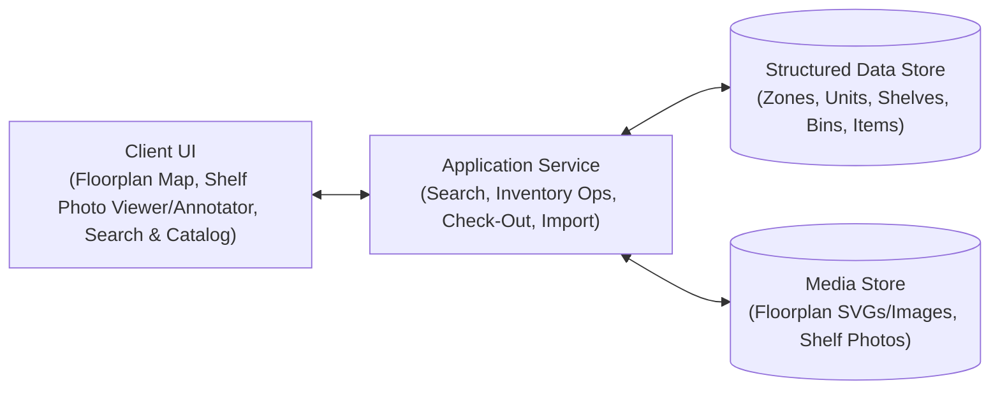

# Lab Inventory Tracker

A visual inventory management system designed for the **Quadrotor Control and Perception Lab** to make locating drone parts, fasteners, perception hardware, and shared tools fast and intuitive.

---

## 1. Project Overview

### Purpose
In a robotics and quadrotor research lab, small components (M2/M3 fasteners, standoffs, XT60 connectors, propellers, ESCs), expensive perception sensors (stereo/depth cameras, LiDAR, IMUs), and shared tools are distributed across multiple workbenches, cabinets, and storage bins. Finding a specific part often requires asking labmates or opening dozens of drawers.

**Lab Inventory Tracker** solves this by pairing a searchable parts catalog with two visual locating layers:
1. **Interactive Lab Floorplan**: Pinpoints the exact room, workbench, rack, or cabinet.
2. **Annotated Shelf & Bin Photos**: Displays a photo of the shelf or drawer with tagged regions/bounding boxes highlighting the exact bin or compartment.

### Target Scope (Quadrotor Control & Perception Lab)
- **Airframe & Propulsion**: Carbon fiber frames, arms, propellers, brushless motors, ESCs.
- **Avionics & Power**: Flight controllers, companion computers, LiPo batteries, BECs, power distribution boards, wiring/connectors.
- **Perception & Sensing**: RGB/depth/event cameras, optical flow sensors, LiDAR, IMUs, motion-capture markers.
- **Fasteners & Hardware**: Metric screws, locknuts, standoffs, vibration dampers, zip ties, adhesives.
- **Tools & Test Equipment**: Soldering stations, multimeters, hex drivers, battery chargers, calibration targets.

---

## 2. Project Requirements

### Functional Requirements (FR)

| ID | Category | Requirement |
| --- | --- | --- |
| **FR-1** | **Visual Floorplan Navigation** | Users can view an interactive 2D map of the lab showing zones, workbenches, racks, and cabinets, and click any storage unit to inspect its shelves/drawers. |
| **FR-2** | **Annotated Shelf & Bin Photos** | Each shelf, drawer, or pegboard supports uploaded photos with interactive tagged regions (pins or bounding boxes) linked to specific bins and parts. |
| **FR-3** | **Part Search & Filtering** | Users can search by part name, specification (e.g., `M3x10`, `4S`, `XT60`), category, or compatible drone platform, and jump directly to its floorplan + shelf photo location. |
| **FR-4** | **Stock & Metadata Tracking** | Each item tracks quantity on hand, unit/packaging, low-stock threshold, vendor/reorder URL, and notes/datasheet links. |
| **FR-5** | **Check-Out / Check-In** | Shared tools, sensors, and flight-test gear can be checked out to a lab member or drone build and returned when finished. |
| **FR-6** | **Map & Photo Authoring** | Authorized lab members can place/move storage units on the floorplan, upload new shelf photos, and draw or reposition bin tags when storage is reorganized. |
| **FR-7** | **Bulk Hardware Import** | The system supports importing an existing hardware inventory list (e.g., CSV/JSON/Markdown table) to bootstrap the catalog. |

### Non-Functional Requirements (NFR)

- **NFR-1 — Speed to Locate**: A user should be able to go from typing a part query to seeing the exact highlighted bin photo in **≤ 3 interactions**.
- **NFR-2 — Low Maintenance Overhead**: Updating a moved bin or restocking an item should take seconds so lab members actually keep the inventory accurate.
- **NFR-3 — Tech-Agnostic & Portable**: Data models, media assets (floorplan + shelf photos), and application logic are cleanly decoupled so the system can be implemented on any web or local-first stack.
- **NFR-4 — Mobile & Desktop Friendly**: Usable both at a lab workstation and on a phone/tablet while standing in front of a storage rack.

---

## 3. Design Overview

### High-Level Architecture

### Visual Locating Flow

1. **Search**: Lab member searches `"M3x12 standoff"` or `"RealSense D435"`.
2. **Floorplan Highlight**: The lab floorplan highlights the target `StorageUnit` (e.g., *Cabinet B — Fasteners*).
3. **Shelf Photo Overlay**: Selecting the unit opens the relevant `Shelf / Drawer` photo with the target `Bin / TagRegion` highlighted.

### Core Domain Model

```mermaid
erDiagram
    ZONE ||--o{ STORAGE_UNIT : contains
    STORAGE_UNIT ||--o{ SHELF : has
    SHELF ||--o{ BIN_TAG : displays
    BIN_TAG ||--o{ ITEM : stores
    ITEM ||--o{ CHECKOUT_LOG : tracks

    ZONE {
        string id
        string name
        string floorplan_asset
    }
    STORAGE_UNIT {
        string id
        string zone_id
        string label
        string unit_type
        float map_x
        float map_y
        float width
        float height
    }
    SHELF {
        string id
        string storage_unit_id
        string label
        string photo_asset
    }
    BIN_TAG {
        string id
        string shelf_id
        string label
        string shape_type
        string coordinates
    }
    ITEM {
        string id
        string bin_tag_id
        string name
        string category
        string specs
        int quantity
        int min_quantity
        string reorder_url
        string compatible_platforms
    }
    CHECKOUT_LOG {
        string id
        string item_id
        string borrower
        string purpose
        datetime checked_out_at
        datetime returned_at
    }
```

---

## 4. Features Management System

### Status Legend
- `Planned` — Scoped and prioritized, not yet started.
- `In Progress` — Currently being designed or implemented.
- `Implemented` — Completed and verified.
- `Deferred` — Backlogged for a future milestone.

### Feature Roadmap

#### Phase 1 — MVP (Visual Locating & Core Catalog)
| ID | Feature | Description | Priority | Status |
| --- | --- | --- | --- | --- |
| **F-01** | Interactive Lab Floorplan | Render lab room/zones with clickable cabinets, racks, and workbenches. | P0 | `Planned` |
| **F-02** | Shelf Photo Viewer & Tagger | Upload shelf/drawer photos and pin/draw bounding boxes for bins. | P0 | `Planned` |
| **F-03** | Search & Instant Locate | Search parts by name/spec/category and highlight floorplan + bin photo. | P0 | `Planned` |
| **F-04** | Core Item CRUD & Stock Counts | Add, edit, move, and adjust quantities for parts and tools. | P0 | `Planned` |
| **F-05** | Hardware List Import | Bulk-import initial quadrotor lab hardware catalog. | P0 | `Planned` |

#### Phase 2 — v1.0 (Lab Operations & Workflows)
| ID | Feature | Description | Priority | Status |
| --- | --- | --- | --- | --- |
| **F-06** | Low-Stock Alerts & Reorder Queue | Flag items below `min_quantity` with direct vendor links. | P1 | `Planned` |
| **F-07** | Tool & Sensor Check-Out | Track who borrowed shared tools, cameras, or test equipment. | P1 | `Planned` |
| **F-08** | Drone Platform BOM Linking | Tag parts by compatible quadrotor platform/build for quick kit assembly. | P1 | `Planned` |
| **F-09** | Mobile Quick-Lookup View | Streamlined layout for scanning/searching while at a shelf. | P1 | `Planned` |

#### Phase 3 — Future (Smart Lab Extensions)
| ID | Feature | Description | Priority | Status |
| --- | --- | --- | --- | --- |
| **F-10** | QR / Barcode Bin Labels | Printable labels that deep-link directly to a bin or shelf view. | P2 | `Deferred` |
| **F-11** | LiPo Battery Cycle & Health Log | Track cell count, storage voltage, cycle count, and retirement status. | P2 | `Deferred` |
| **F-12** | Datasheet & CAD Attachments | Attach pinouts, STEP files, and calibration notes directly to parts. | P2 | `Deferred` |

---

## 5. Hardware Inventory Appendix (Draft Placeholder)

> **Next Step**: Populate this section (or a linked `inventory/` data file) with the lab's current hardware list to seed **F-05 (Hardware List Import)**.

Suggested fields for the initial hardware list:
- **Item Name** (e.g., `M3x10 Socket Head Cap Screw`, `Holybro Pixhawk 6X`, `Intel RealSense D435i`)
- **Category** (`Fasteners`, `Propulsion`, `Avionics`, `Perception`, `Power`, `Tools`)
- **Specs / Notes**
- **Quantity** & **Min Threshold**
- **Location** (`Zone` → `Storage Unit` → `Shelf/Drawer` → `Bin`)
- **Reorder URL / SKU**
