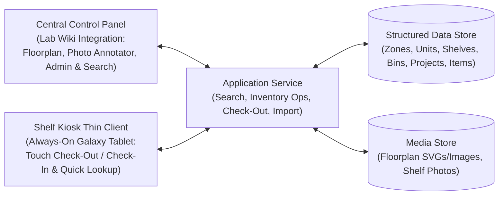
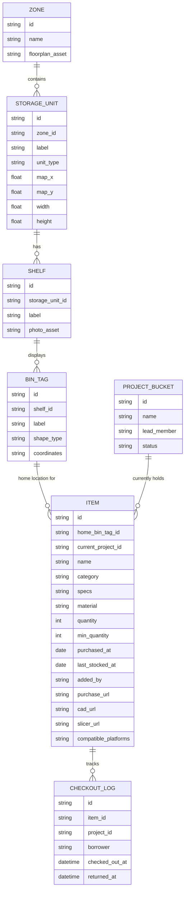

# Design Overview

## High-Level Architecture

The system exposes two tailored client surfaces backed by a single application service, structured data store, and media store:

1. **Central Control Panel (Lab Wiki Integration)**: Full-featured management UI for floorplan editing, shelf photo annotation, catalog administration, provenance logging, and project bucket auditing.
2. **Shelf Kiosk Thin Client (Always-On Galaxy Tablet)**: Lightweight, touch-first kiosk UI mounted next to the storage shelves for fast check-out to a project bucket and check-in back to a home bin.

---

## Visual Locating Flow

1. **Search**: Lab member searches by part name, spec, material, or category.
2. **Assignment Check**: System shows whether the item is currently in its **Home Bin** or checked out to a **Project Bucket**.
3. **Floorplan Highlight**: If in storage, the lab floorplan highlights the target `StorageUnit` (rack, shelf, or caddy).
4. **Shelf Photo Overlay**: Selecting the unit opens the relevant `Shelf / Drawer` photo with the target `Bin / TagRegion` highlighted.

---

## Home Bin & Project Bucket Workflow

Every tracked item exists in one of two mutually exclusive states:

- **In Home Bin** (`current_project_id = null`): The item is unassigned and physically stored in its designated `home_bin_tag_id`.
- **In Project Bucket** (`current_project_id != null`): The item is actively assigned/checked out to a specific lab project or drone build. Checking the item back in clears `current_project_id` and directs the user to return it to its **Home Bin** (with the shelf photo highlight).

---

## Core Domain Model

